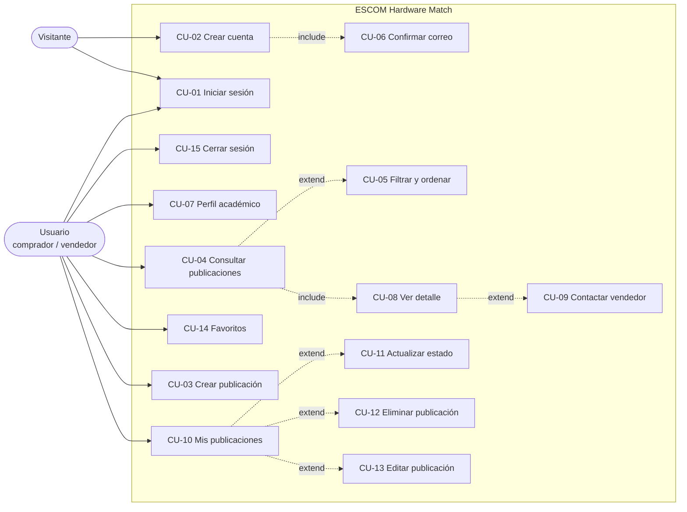

# Instituto Politécnico Nacional
## Escuela Superior de Cómputo (ESCOM)
### Trabajo Terminal No. 2027-A196

**"Prototipo de aplicación web para la recomendación de publicaciones de oferta de laptops y tabletas entre la comunidad de la ESCOM"**

* **Alumnos:** Granados Martínez Pablo Daniel, López Hernández Alan
* **Directora:** M. en C. Galiñanes Rodríguez María Gabriela

---

## 1. Introducción y alcance

Este documento especifica los casos de uso, las reglas de negocio, los filtros y el algoritmo de compatibilidad **implementados en el prototipo**. Para la arquitectura y el detalle técnico consulta la [documentación técnica](docs/DOCUMENTACION_TECNICA.md); para el modelo de datos, la [documentación de la base de datos](docs/base_de_datos/DOCUMENTACION_BASE_DE_DATOS.md).

### 1.1 Resumen de casos de uso

| ID | Caso de uso | Actor | Pág. del documento TT | Backend | Interfaz |
| :-: | :--- | :--- | :-: | :-: | :-: |
| CU-01 | Iniciar sesión | Usuario registrado | 1 | Sí | Sí |
| CU-02 | Crear nueva cuenta | Visitante | 2 | Sí | Sí |
| CU-03 | Crear publicación de oferta | Vendedor | 9 | Sí | Sí |
| CU-04 | Consultar publicaciones de oferta | Comprador | 16-20 | Sí | Sí |
| CU-05 | Filtrar y ordenar publicaciones | Comprador | 16-20 | Sí | Sí |
| CU-06 | Confirmar correo de verificación | Usuario registrado | 4-5 | Sí | Sí |
| CU-07 | Consultar y editar perfil académico | Usuario registrado | 6-8 | Sí | Sí |
| CU-08 | Ver detalle de una publicación | Comprador | 13, 28 | Sí | Sí |
| CU-09 | Contactar al vendedor | Comprador | 32 | Sí | Sí |
| CU-10 | Consultar mis publicaciones | Vendedor | 12 | Sí | Sí |
| CU-11 | Actualizar estado de una publicación | Vendedor | 14 | Sí | Sí |
| CU-12 | Eliminar publicación | Vendedor | 11 | Sí | Sí |
| CU-13 | Editar publicación | Vendedor | 10 | Sí | Sí |
| CU-14 | Gestionar favoritos | Comprador | 42-44 | Sí | Sí |
| CU-15 | Cerrar sesión | Usuario registrado | — | Sí | Sí |

> Pendiente para fases posteriores del TT: valoraciones de vendedores, reportes, notificaciones y recomendación híbrida. El backend ya devuelve la bandera `invite_rating` al vender la última pieza, pero la interfaz de valoraciones aún no existe.

---

## 2. Diagrama de casos de uso



---

## 3. Especificación de casos de uso

### CU-01 · Iniciar sesión

| Campo | Descripción |
| :--- | :--- |
| **Actor** | Usuario registrado |
| **Propósito** | Autenticar al usuario para acceder a sus ofertas y al cálculo personalizado de compatibilidad. |
| **Precondición** | Existe una cuenta con el correo capturado. |
| **Flujo principal** | 1. El usuario abre la aplicación y ve la pantalla *Iniciar sesión*.<br/>2. Captura correo y contraseña y presiona **Entrar**.<br/>3. El sistema normaliza el correo (minúsculas, sin espacios) y valida la contraseña contra el hash `scrypt`.<br/>4. El sistema genera un token de sesión, guarda su hash SHA-256 en `sessions` y envía una cookie `HttpOnly`.<br/>5. La interfaz muestra la página principal. |
| **Flujos alternos** | **3a. Credenciales incorrectas:** HTTP 401 «Correo o contraseña incorrectos»; el usuario puede reintentar.<br/>**3b. Servidor no disponible:** la interfaz muestra un aviso de conexión y conserva lo capturado. |
| **Postcondición** | Sesión activa durante `SESSION_TTL_SECONDS` (3600 s por defecto). Al recargar la página la sesión se restaura con `GET /auth/me`. |

### CU-02 · Crear nueva cuenta

| Campo | Descripción |
| :--- | :--- |
| **Actor** | Visitante |
| **Propósito** | Registrar al usuario con su perfil académico para alimentar el motor de recomendación. |
| **Precondición** | El correo no está registrado. |
| **Flujo principal** | 1. El usuario elige **Regístrate aquí**.<br/>2. Captura nombre, rol (Alumno, Docente, PAAE o Externo), teléfono opcional, correo y contraseña (mínimo 8 caracteres).<br/>3. Si el rol es **Alumno**, elige carrera (ISC, IIA, LCD, ISISA) y semestre (1° a 8°).<br/>4. Selecciona sus áreas de interés de un catálogo predefinido.<br/>5. El sistema valida los datos, calcula el hash `scrypt` y crea el usuario con `is_verified = false` y un token de verificación.<br/>6. El sistema abre la sesión y muestra la pantalla de confirmación de correo (CU-06). |
| **Flujos alternos** | **5a. Correo duplicado:** HTTP 409 «El correo electrónico ya se encuentra registrado».<br/>**5b. Datos inválidos:** HTTP 422 con el campo observado. |
| **Postcondición** | Usuario almacenado en `users` con su perfil académico. |

### CU-03 · Crear publicación de oferta

| Campo | Descripción |
| :--- | :--- |
| **Actor** | Vendedor (usuario con sesión) |
| **Propósito** | Publicar un equipo con la ficha técnica estandarizada. |
| **Precondición** | Sesión iniciada. |
| **Flujo principal** | 1. El usuario abre **Vender equipo**.<br/>2. Captura tres bloques: **Datos generales** (tipo, condición, título, marca, modelo), **Ficha técnica** (procesador, RAM, almacenamiento, tipo de disco, GPU, pantalla, batería) y **Precio y entrega** (precio MXN, piezas, teléfono de contacto, foto, descripción).<br/>3. Presiona **Publicar oferta**.<br/>4. El sistema valida rangos (RN-04) y revisa duplicados (RN-09).<br/>5. El sistema guarda la oferta con estado `Activa` y la muestra en el catálogo. |
| **Flujos alternos** | **4a. Datos fuera de rango:** HTTP 422; la interfaz muestra el error.<br/>**4b. Duplicado exacto (RN-09):** se suman las piezas a la oferta existente y se reactiva.<br/>**4c. Sesión expirada:** HTTP 401; se solicita iniciar sesión. |
| **Postcondición** | Oferta en `publications`, visible en el catálogo y en *Mis publicaciones*. Si no se indica foto, se asigna una imagen genérica según el tipo de equipo. |

### CU-04 · Consultar publicaciones de oferta

| Campo | Descripción |
| :--- | :--- |
| **Actor** | Comprador |
| **Propósito** | Explorar las ofertas activas y evaluar su compatibilidad. |
| **Precondición** | Sesión iniciada. |
| **Flujo principal** | 1. El usuario abre **Explorar**.<br/>2. El sistema lista las publicaciones con estado `Activa`, de la más reciente a la más antigua.<br/>3. Cada tarjeta muestra foto, tipo, marca y modelo, título, procesador, RAM, almacenamiento, precio y, si aplica, el puntaje y la etiqueta de compatibilidad.<br/>4. El usuario puede refinar el listado (CU-05) o abrir una oferta (CU-08). |
| **Flujos alternos** | **2a. Sin resultados:** mensaje «No se encontraron publicaciones» con la opción de ver todas. |
| **Postcondición** | El usuario identifica equipos adecuados a su carrera. |

### CU-05 · Filtrar y ordenar publicaciones

| Campo | Descripción |
| :--- | :--- |
| **Actor** | Comprador |
| **Relación** | Extiende a CU-04 |
| **Propósito** | Reducir el catálogo a los equipos que cumplen los criterios técnicos, comerciales y de compatibilidad. |
| **Precondición** | Existen publicaciones activas. Para el filtro de compatibilidad, el perfil académico debe estar completo (RN-03). |
| **Flujo principal** | 1. El usuario escribe en el buscador o elige filtros (tabla 5).<br/>2. El sistema aplica **todos** los filtros de forma combinada (operador Y).<br/>3. El sistema ordena el resultado según el criterio elegido.<br/>4. La interfaz muestra el número de ofertas y de filtros activos.<br/>5. **Limpiar** restablece los filtros. |
| **Flujos alternos** | **2a. Perfil incompleto:** al activar *Compatibilidad con mi carrera* sin carrera y semestre, se informa que debe completar su perfil.<br/>**2b. Precio mínimo mayor al máximo:** el resultado es una lista vacía. |
| **Postcondición** | El catálogo refleja solo las ofertas que cumplen todos los criterios. |

### CU-06 · Confirmar correo de verificación

| Campo | Descripción |
| :--- | :--- |
| **Actor** | Usuario recién registrado |
| **Propósito** | Confirmar la cuenta y, si el correo es institucional, asignar la insignia IPN. |
| **Flujo principal** | 1. Tras el registro, la interfaz ofrece **Confirmar correo y entrar**.<br/>2. El sistema recibe el token, marca `is_verified = true` y borra el token.<br/>3. Si el dominio del correo termina en `ipn.mx`, asigna la insignia (`es_institucional = true`, RN-02). |
| **Flujos alternos** | **2a. Token inválido:** HTTP 400 «Enlace o token de verificación inválido o expirado». |
| **Nota** | En el prototipo no se envía correo real: el token se entrega en la respuesta del registro para simular el enlace de verificación. |

### CU-07 · Consultar y editar perfil académico

| Campo | Descripción |
| :--- | :--- |
| **Actor** | Usuario registrado |
| **Flujo principal** | 1. En **Mi perfil** el usuario ve nombre, correo, rol, carrera, semestre, intereses, insignia IPN y si su perfil permite calcular compatibilidad.<br/>2. **Editar perfil** permite cambiar carrera, semestre, teléfono e intereses; el sistema guarda los cambios.<br/>3. **Restablecer datos** borra carrera, semestre e intereses. |
| **Postcondición** | Si se restablece el perfil, el filtro de compatibilidad queda deshabilitado hasta capturarlo de nuevo (RN-03). |

### CU-08 · Ver detalle de una publicación

| Campo | Descripción |
| :--- | :--- |
| **Actor** | Comprador |
| **Flujo principal** | 1. El usuario abre una tarjeta.<br/>2. Se muestra una ventana con foto, precio, condición, existencias, estado, ficha técnica completa, descripción, datos públicos del vendedor (nombre, rol, carrera, insignia IPN) y la justificación de compatibilidad.<br/>3. Puede copiar el enlace o guardar la oferta en favoritos (CU-14). |
| **Flujos alternos** | **1a. Oferta inexistente:** HTTP 404 «Publicación no encontrada». |

### CU-09 · Contactar al vendedor

| Campo | Descripción |
| :--- | :--- |
| **Actor** | Comprador con sesión |
| **Flujo principal** | 1. En el detalle, el usuario presiona **Contactar al vendedor**.<br/>2. El sistema devuelve el contacto (teléfono de la oferta; si no existe, el del perfil; si tampoco, el correo del vendedor).<br/>3. La interfaz muestra el teléfono y el enlace **Enviar mensaje por WhatsApp**. |
| **Flujos alternos** | **2a. El usuario es el vendedor (RN-10):** HTTP 400 «Eres el vendedor de esta publicación».<br/>**2b. Sin sesión:** HTTP 401. |
| **Nota de privacidad** | El teléfono **no** viaja en los listados ni en el detalle; solo se obtiene en esta acción y únicamente con sesión. El propietario sí ve el teléfono de sus propias ofertas. |

### CU-10 · Consultar mis publicaciones

| Campo | Descripción |
| :--- | :--- |
| **Actor** | Vendedor |
| **Flujo principal** | 1. El usuario abre **Mis publicaciones**.<br/>2. El sistema lista todas sus ofertas (cualquier estado), de la más reciente a la más antigua, con estado y existencias.<br/>3. Desde cada tarjeta puede ver el detalle, editar o eliminar la oferta; desde el detalle puede cambiar su estado o editarla. |

### CU-11 · Actualizar estado de una publicación

| Campo | Descripción |
| :--- | :--- |
| **Actor** | Vendedor propietario |
| **Flujo principal** | 1. En el detalle de su oferta elige **Marcar como vendida** o **Reactivar oferta**.<br/>2. El sistema actualiza el estado (`Activa`, `Vendida` u `Obsoleta`) y la fecha de modificación.<br/>3. Si el estado es `Vendida`, las existencias pasan a 0 (si había una sola pieza, la respuesta incluye `invite_rating = true`). Si se reactiva a `Activa` con existencias en 0, el stock se restablece a 1. |
| **Flujos alternos** | **1a. No es el propietario:** HTTP 403.<br/>**1b. Oferta inexistente:** HTTP 404. |

### CU-12 · Eliminar publicación

| Campo | Descripción |
| :--- | :--- |
| **Actor** | Vendedor propietario |
| **Flujo principal** | 1. Presiona **Eliminar** y confirma.<br/>2. El sistema borra la publicación y sus favoritos asociados (HTTP 204). |
| **Flujos alternos** | **1a. No es el propietario:** HTTP 403. |

### CU-13 · Editar publicación

| Campo | Descripción |
| :--- | :--- |
| **Actor** | Vendedor propietario |
| **Flujo principal** | 1. En **Mis publicaciones** o en el modal de detalle de su oferta, el vendedor presiona **Editar**.<br/>2. La vista de publicación precarga los datos actuales del equipo.<br/>3. Al guardar cambios, `PUT /api/publications/{id}` valida la ficha técnica (RN-04), actualiza los campos y registra la nueva fecha de modificación (`updated_at`). |
| **Flujos alternos** | **3a. No es el propietario:** HTTP 403.<br/>**3b. Oferta inexistente:** HTTP 404. |

### CU-14 · Gestionar favoritos

| Campo | Descripción |
| :--- | :--- |
| **Actor** | Comprador |
| **Flujo principal** | 1. En el detalle de una oferta ajena, el usuario elige **Guardar en favoritos** (o quitarla).<br/>2. En **Favoritos** consulta la lista y puede **Quitar** elementos.<br/>3. La operación de agregar es idempotente: no duplica el favorito y devuelve HTTP 404 si la publicación no existe. |

### CU-15 · Cerrar sesión

| Campo | Descripción |
| :--- | :--- |
| **Actor** | Usuario registrado |
| **Flujo principal** | El usuario presiona **Salir**; el sistema borra el hash del token en `sessions` y elimina la cookie (HTTP 204). |

---

## 4. Reglas de negocio

| ID | Regla | Dónde se aplica |
| :-: | :--- | :--- |
| RN-01 | Toda cuenta nueva nace sin verificar y con un token de verificación. | CU-02, CU-06 |
| RN-02 | Tras verificar el correo, si el dominio termina en `ipn.mx` se asigna la insignia institucional. | CU-06 |
| RN-03 | El filtro de compatibilidad exige perfil completo: para alumnos, carrera y semestre. Docentes, PAAE y externos se consideran completos. | CU-05, CU-07 |
| RN-04 | Ficha técnica estandarizada con validaciones: título de 3 a 200 caracteres, RAM de 2 a 256 GB, almacenamiento de 16 a 16 384 GB, precio mayor a 0, piezas mínimas 1, descripción de 5 a 2 500 caracteres. | CU-03, CU-13 |
| RN-05 | El filtro de compatibilidad conserva solo ofertas con puntaje de 80 % o más, ordenadas de mayor a menor. | CU-05 |
| RN-06 | El contacto del vendedor solo se entrega a usuarios con sesión y mediante una acción explícita. | CU-09 |
| RN-07 | Prioridad del contacto: teléfono de la oferta, luego teléfono del perfil, luego correo. | CU-09 |
| RN-08 | Obsolescencia: al iniciar el backend, las ofertas `Activa` sin modificarse en 30 días pasan a `Obsoleta`. | Inicio del backend |
| RN-09 | Duplicados: si el vendedor ya tiene una oferta con la misma marca, modelo, procesador, RAM y almacenamiento y la **misma descripción**, se suman las piezas y se reactiva; si la descripción difiere, se crea una oferta nueva. Al vender, las existencias pasan a 0. | CU-03, CU-11 |
| RN-10 | El vendedor no puede solicitar el contacto de su propia oferta. | CU-09 |

---

## 5. Catálogo de filtros

Los filtros se envían como parámetros de `GET /api/publications` y se combinan con **Y**. El catálogo siempre excluye ofertas con estado distinto de `Activa`.

| # | Filtro | Control | Valores | Parámetro | Campo evaluado | Criterio |
| :-: | :--- | :--- | :--- | :--- | :--- | :--- |
| F-01 | Búsqueda por texto | Campo de búsqueda | Texto libre | `search` | `title`, `brand`, `model`, `processor`, `description` | Contiene (sin distinguir mayúsculas) |
| F-02 | Tipo de equipo | Lista | Laptop, Tableta | `device_type` | `device_type` | Igual a |
| F-03 | Marca | Lista dinámica | Marcas con ofertas activas | `brand` | `brand` | Igual a |
| F-04 | Condición | Lista | Nuevo, Como nuevo, Buen estado, Con detalles | `condition` | `condition` | Igual a |
| F-05 | RAM mínima | Lista | 4, 8, 12, 16, 24, 32 GB | `min_ram` | `ram_gb` | Mayor o igual |
| F-06 | Almacenamiento mínimo | Lista | 128 GB, 256 GB, 512 GB, 1 TB | `min_storage` | `storage_gb` | Mayor o igual |
| F-07 | Tipo de disco | Lista | SSD NVMe, SSD SATA, HDD, eMMC | `storage_type` | `storage_type` | Igual a |
| F-08 | Tarjeta gráfica | Lista | Dedicada, Integrada | `gpu_type` | `gpu` | Integrada si es nula o contiene «integrada», «intel iris», «intel uhd», «vega», «radeon graphics» o «adreno» |
| F-09 | Precio mínimo | Campo numérico | MXN | `min_price` | `price` | Mayor o igual |
| F-10 | Precio máximo | Campo numérico | MXN | `max_price` | `price` | Menor o igual |
| F-11 | Vendedor con correo IPN | Casilla | Sí / No | `ipn_sellers_only` | `users.es_institucional` | Verdadero |
| F-12 | Compatibilidad con mi carrera | Botón | Activado / Desactivado | `only_compatible` | Puntaje CBF | Mayor o igual a 80 % |
| F-13 | Ordenar por | Lista | Más recientes, Precio menor a mayor, Precio mayor a menor, Mayor compatibilidad | `sort_by` | `created_at`, `price`, puntaje CBF | Orden |

Ejemplo:

```
GET /api/publications?device_type=Laptop&min_ram=16&gpu_type=dedicada&max_price=20000&sort_by=precio_asc
```

---

## 6. Algoritmo de compatibilidad (línea base CBF)

El motor evalúa la pareja *(especificaciones del equipo, perfil del comprador)* contra las exigencias del plan de estudios 2020. Una GPU se considera **dedicada** si su descripción no contiene términos de gráficos integrados; los procesadores Apple M1 a M4 se tratan como aceleración gráfica equivalente.

| Carrera | Condición | Puntaje | Etiqueta |
| :--- | :--- | :-: | :--- |
| **IIA** | GPU dedicada o Apple M y RAM ≥ 16 GB | 96 % | Altamente compatible con IIA |
| | RAM ≥ 16 GB | 83 % | Compatible para fundamentos de IA |
| | RAM ≥ 8 GB | 72 % | Aceptable para primeros semestres |
| | Otro caso | 58 % | No recomendado para IA |
| **ISC** | RAM ≥ 16 GB y disco SSD | 95 % | Altamente compatible con ISC |
| | RAM ≥ 8 GB | 85 % | Compatible con plan ISC |
| | Otro caso | 65 % | Básico para ISC |
| **LCD** | RAM ≥ 16 GB y disco SSD | 94 % | Altamente compatible con LCD |
| | RAM ≥ 8 GB | 80 % | Compatible con análisis básico |
| | Otro caso | 60 % | Rendimiento limitado para LCD |
| **ISISA** | GPU dedicada o Apple M y RAM ≥ 16 GB | 95 % | Altamente compatible con ISISA |
| | RAM ≥ 8 GB | 78 % | Compatible para diseño ligero |
| | Otro caso | 60 % | Limitado para CAD |
| **Sin carrera** (docente, PAAE, externo o alumno sin perfil) | RAM ≥ 16 GB | 90 % | Equipo de alto rendimiento |
| | RAM ≥ 8 GB | 82 % | Equipo balanceado |
| | Otro caso | 70 % | Gama básica |

Cada puntaje se acompaña de un texto explicativo que se muestra en la tarjeta y en el detalle.

---

## 7. API REST

Documentación interactiva: `http://localhost:8000/docs`.

| Método | Endpoint | Descripción | Sesión |
| :-: | :--- | :--- | :-: |
| `GET` | `/` | Estado del servicio | No |
| `POST` | `/auth/register` | Crea la cuenta y abre sesión | No |
| `POST` | `/auth/verify-email?token=` | Confirma el correo | No |
| `POST` | `/auth/login` | Inicia sesión | No |
| `GET` | `/auth/me` | Usuario de la sesión actual | Sí |
| `PUT` | `/auth/profile` | Actualiza carrera, semestre, intereses o teléfono | Sí |
| `DELETE` | `/auth/profile` | Restablece carrera, semestre e intereses | Sí |
| `POST` | `/auth/logout` | Cierra la sesión | No |
| `GET` | `/api/filters/options` | Opciones para los filtros (marcas, rango de precios) | No |
| `GET` | `/api/publications` | Lista ofertas activas con filtros F-01 a F-13 | Opcional |
| `GET` | `/api/publications/{id}` | Detalle de una oferta | Opcional |
| `GET` | `/api/publications/{id}/contact` | Contacto del vendedor | Sí |
| `POST` | `/api/publications` | Crea una oferta | Sí |
| `PUT` | `/api/publications/{id}` | Edita una oferta propia | Sí |
| `PATCH` | `/api/publications/{id}/status` | Cambia el estado de una oferta propia | Sí |
| `DELETE` | `/api/publications/{id}` | Elimina una oferta propia | Sí |
| `GET` | `/api/my-publications` | Ofertas del usuario | Sí |
| `GET` | `/api/favorites` | Favoritos del usuario | Sí |
| `POST` | `/api/favorites/{id}` | Agrega a favoritos | Sí |
| `DELETE` | `/api/favorites/{id}` | Quita de favoritos | Sí |

Los parámetros, cuerpos y códigos de respuesta se detallan en la [documentación técnica](docs/DOCUMENTACION_TECNICA.md#5-referencia-de-la-api).
