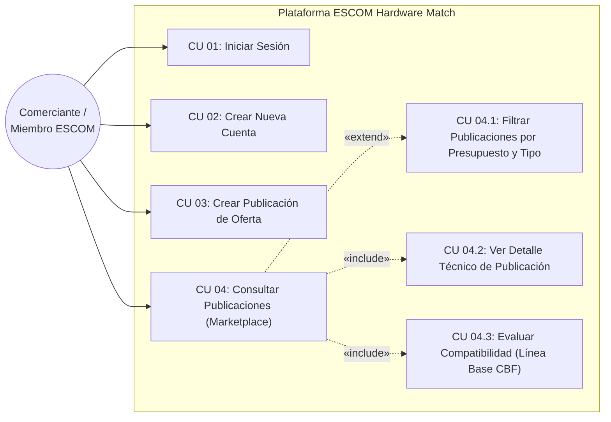
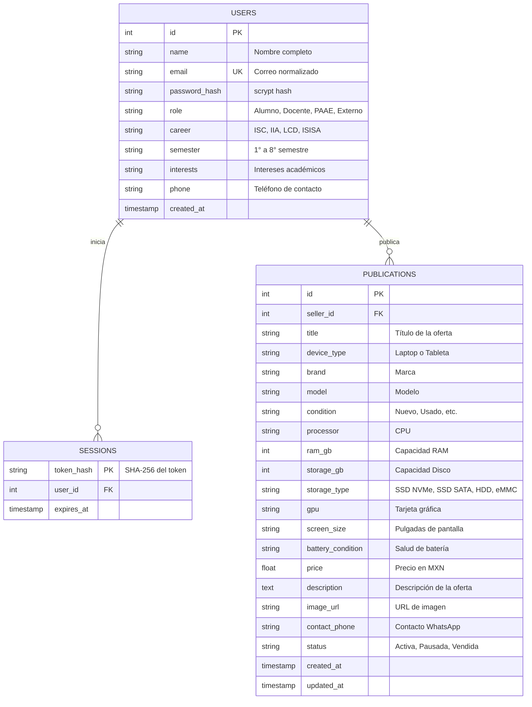

# Instituto Politécnico Nacional
## Escuela Superior de Cómputo (ESCOM)
### Trabajo Terminal No. 2027-A196
**"Prototipo de aplicación web para la recomendación de publicaciones de oferta de laptops y tabletas entre la comunidad de la ESCOM"**

* **Alumnos:** Granados Martínez Pablo Daniel, López Hernández Alan  
* **Directora:** M. en C. Galiñanes Rodríguez María Gabriela  

---

## 1. Introducción y Alcance de la Fase 1

El presente documento detalla la especificación formal de requisitos, diseño de datos y casos de uso correspondientes a la **Fase 1 del desarrollo del prototipo** (Sprints 1 al 5 del cronograma de TT1). Esta entrega comprende:

1. **CU-01 Iniciar Sesión (Login):** Autenticación segura mediante cookies `HttpOnly` y hashing scrypt.
2. **CU-02 Crear Nueva Cuenta (Registro de Perfil Académico):** Registro abierto con captura del rol institucional (Alumno, Docente, PAAE, Externo), carrera ESCOM (ISC, IIA, LCD, ISISA), semestre y catálogo predefinido de intereses.
3. **CU-03 Crear Publicación de Oferta:** Formulario estandarizado de laptops y tabletas con especificaciones técnicas detalladas (procesador, RAM, almacenamiento, GPU, estado, batería, precio y contacto).
4. **CU-04 Consultar Publicaciones de Oferta (Página Principal / Marketplace):** Exploración de catálogo con barra de búsqueda, filtros por categoría/presupuesto, visualización de fichas técnicas en modal y etiquetado dinámico de compatibilidad académica.

---

## 2. Diagrama de Casos de Uso de la Fase 1

Basado en el diagrama general de casos de uso del Trabajo Terminal, este subconjunto delimita el núcleo operativo del marketplace:

---

## 3. Especificación Formal de Casos de Uso

### Caso de Uso CU-01: Iniciar Sesión

| Campo | Descripción |
| :--- | :--- |
| **Identificador** | **CU-01** |
| **Nombre** | Iniciar Sesión |
| **Actor Principal** | Comerciante / Usuario registrado |
| **Propósito** | Autenticar al usuario para acceder a sus ofertas, preferencias y cálculo personalizado de compatibilidad técnica. |
| **Precondiciones** | El usuario debe poseer una cuenta previamente creada en la plataforma. |
| **Flujo Principal** | 1. El usuario navega a la pantalla de autenticación. 2. El sistema presenta el formulario de inicio de sesión solicitando correo electrónico y contraseña. 3. El usuario ingresa sus credenciales y hace clic en **"Entrar a la plataforma"**. 4. El sistema normaliza el correo y valida la contraseña contra el hash scrypt almacenado en la base de datos. 5. El sistema genera un token de sesión criptográfico, lo persiste en la tabla `sessions` y emite una cookie segura `HttpOnly`. 6. El sistema redirige al usuario a la vista principal (Marketplace) mostrando su perfil y ofertas adaptadas. |
| **Flujos Alternos / Errores** | **4a. Credenciales incorrectas:** El sistema detecta contraseña errónea o correo no registrado; responde con código HTTP 401 y muestra: *"Correo o contraseña incorrectos"*. Permite reintentar. **4b. Error de conexión:** El sistema reporta fallo al contactar al servidor y mantiene los campos editables. |
| **Postcondiciones** | Sesión activa en el cliente y servidor; disponibilidad del perfil académico para el filtrado CBF. |

---

### Caso de Uso CU-02: Crear Nueva Cuenta (Registro de Perfil)

| Campo | Descripción |
| :--- | :--- |
| **Identificador** | **CU-02** |
| **Nombre** | Crear Nueva Cuenta / Registro Institucional |
| **Actor Principal** | Comerciante / Miembro de la comunidad (Alumno, Docente, PAAE o Externo) |
| **Propósito** | Dar de alta a un usuario capturando sus datos esenciales y su perfil académico (carrera, semestre e intereses) para el motor de recomendación. |
| **Precondiciones** | No poseer una cuenta activa con el mismo correo electrónico. |
| **Flujo Principal** | 1. El usuario selecciona la opción **"¿No tienes cuenta? Regístrate aquí"**. 2. El sistema despliega el formulario con campos: Nombre completo, Rol, Correo, Contraseña, Teléfono/WhatsApp. 3. Al seleccionar el rol **Alumno**, el sistema despliega selectores para: Carrera (ISC, IIA, LCD, ISISA), Semestre (1° a 8°) y el catálogo de intereses predefinidos. 4. El usuario completa los datos, selecciona sus áreas de interés mediante botones chip y presiona **"Completar Registro"**. 5. El backend valida la unicidad del correo, computa el hash criptográfico `scrypt` de la contraseña y crea el registro en la base de datos relacional. 6. El sistema inicia sesión automáticamente al usuario y lo transfiere al catálogo principal con su perfil configurado. |
| **Flujos Alternos / Errores** | **5a. Correo ya registrado:** El sistema detecta colisión de correo en la tabla `users`; emite código HTTP 409: *"El correo electrónico ya se encuentra registrado"*. **5b. Datos inválidos:** Falta de campos obligatorios o formato de correo inválido; el sistema emite código HTTP 422 y destaca los campos con error. |
| **Postcondiciones** | Registro persistido en la tabla `users` con atributos curriculares listos para el contraste de hardware. |

---

### Caso de Uso CU-03: Crear Publicación de Oferta (Estandarizada)

| Campo | Descripción |
| :--- | :--- |
| **Identificador** | **CU-03** |
| **Nombre** | Crear Publicación de Oferta de Laptop o Tableta |
| **Actor Principal** | Comerciante (Vendedor) |
| **Propósito** | Publicar una oferta de equipo de cómputo estructurada bajo la ficha técnica estandarizada definida en el protocolo de TT. |
| **Precondiciones** | El usuario debe haber iniciado sesión en la plataforma. |
| **Flujo Principal** | 1. El usuario hace clic en la pestaña **"+ Publicar Equipo"**. 2. El sistema muestra el formulario dividido en tres bloques: &nbsp;&nbsp;&nbsp;&nbsp;a) **Información General:** Tipo (Laptop/Tableta), Condición (Nuevo, Usado - Como nuevo, Usado - Buen estado, etc.), Título, Marca y Modelo. &nbsp;&nbsp;&nbsp;&nbsp;b) **Ficha Técnica:** Procesador (CPU), Memoria RAM (GB), Almacenamiento (GB), Tipo de disco (SSD NVMe, SSD SATA, HDD, eMMC), Tarjeta gráfica (GPU), Pantalla y Batería. &nbsp;&nbsp;&nbsp;&nbsp;c) **Comercial:** Precio en MXN, Teléfono/WhatsApp de contacto, URL de fotografía y descripción detallada. 3. El usuario completa los campos y presiona **"Publicar Oferta en ESCOM"**. 4. El backend valida los rangos numéricos (RAM > 0, Almacenamiento > 0, Precio > 0) y guarda la publicación vinculada al ID del vendedor. 5. El sistema notifica el éxito, refresca el catálogo y redirige a la página principal donde la publicación aparece de inmediato. |
| **Flujos Alternos / Errores** | **4a. Campos incompletos:** Si el precio es menor o igual a cero o faltan especificaciones clave, el sistema bloquea el envío y muestra la advertencia en pantalla. **4b. Sesión expirada:** Si el token caducó, se solicita reautenticación antes de completar el guardado. |
| **Postcondiciones** | Oferta almacenada en la tabla `publications` con estatus `Activa`, visible en el catálogo general y en la sección *Mis Publicaciones*. |

---

### Caso de Uso CU-04: Consultar Publicaciones de Oferta (Página Principal)

| Campo | Descripción |
| :--- | :--- |
| **Identificador** | **CU-04** |
| **Nombre** | Consultar Publicaciones de Oferta (Marketplace) |
| **Actor Principal** | Comerciante (Comprador) |
| **Propósito** | Explorar, buscar y filtrar ofertas de laptops y tabletas disponibles, evaluando su compatibilidad con el plan de estudios del comprador. |
| **Precondiciones** | La plataforma debe estar en ejecución; se recomienda inicio de sesión para visualización de badges personalizados. |
| **Flujo Principal** | 1. El usuario ingresa a la pestaña principal **"Explorar Ofertas"**. 2. El sistema carga las publicaciones activas ordenadas cronológicamente. 3. Para cada equipo, el sistema calcula y exhibe: &nbsp;&nbsp;&nbsp;&nbsp;• Tarjeta con foto, tipo de equipo, marca y condición. &nbsp;&nbsp;&nbsp;&nbsp;• Chips de hardware clave: Procesador, RAM en GB, Almacenamiento y GPU. &nbsp;&nbsp;&nbsp;&nbsp;• Porcentaje de afinidad (*Match*) y badge según el plan de estudios de la carrera del usuario. &nbsp;&nbsp;&nbsp;&nbsp;• Precio en moneda nacional (MXN). 4. El usuario puede refinar los resultados mediante: &nbsp;&nbsp;&nbsp;&nbsp;• Campo de búsqueda por texto (filtra por marca, modelo o procesador en tiempo real). &nbsp;&nbsp;&nbsp;&nbsp;• Selector de tipo (Todos, Laptop, Tableta). &nbsp;&nbsp;&nbsp;&nbsp;• Rango de presupuesto máximo interactivo (Slider MXN). &nbsp;&nbsp;&nbsp;&nbsp;• Casilla de verificación: *"Filtrar sólo alta compatibilidad (>=80%)"*. 5. Al hacer clic en **"Ver Detalle"**, el sistema abre un modal accesible con la ficha técnica desglosada, justificación curricular y botón de contacto directo por WhatsApp con el vendedor. |
| **Postcondiciones** | El usuario identifica equipos óptimos para su carga académica y puede contactar al vendedor dentro de la comunidad ESCOM. |

---

## 4. Esquema de Base de Datos Relacional (PostgreSQL)

El modelo de datos implementado en SQLAlchemy refleja la arquitectura de tres capas:

---

## 5. Algoritmo de Compatibilidad de Perfil (Línea Base CBF - Sprint 5)

El motor de filtrado evalúa la tupla `(Hardware_Specs, Perfil_Estudiante)` contrastándola contra las exigencias del Plan de Estudios 2020 de la ESCOM:

| Carrera | Requerimientos Críticos de Hardware | Criterio de Puntuación (Match %) |
| :--- | :--- | :--- |
| **Ingeniería en Inteligencia Artificial (IIA)** | GPU dedicada con núcleos de cómputo tensorial / CUDA o Apple Silicon M-Series, memoria RAM >= 16 GB, SSD. | • GPU Dedicada/Apple M + RAM >= 16 GB: **96% (Excelente para Deep Learning)** • RAM >= 16 GB con GPU integrada: **83% (Adecuado para fundamentos)** • RAM = 8 GB: **72% (Requiere ampliación)** |
| **Ingeniería en Sistemas Computacionales (ISC)** | Memoria RAM >= 16 GB (para virtualización, Docker, emuladores Android/iOS), CPU multinúcleo y almacenamiento SSD NVMe. | • RAM >= 16 GB + SSD: **95% (Excelente para desarrollo y contenedores)** • RAM = 8 GB + SSD: **85% (Bueno para materias troncales)** • RAM < 8 GB: **65% (Limitado)** |
| **Licenciatura en Ciencia de Datos (LCD)** | Memoria RAM elevada (16 GB - 32 GB) para DataFrames en memoria (Pandas/Spark), CPU veloz para minería y cálculo matricial. | • RAM >= 16 GB + SSD: **94% (Óptimo para Big Data y análisis)** • RAM = 8 GB: **80% (Estadística básica)** |
| **Ingeniería en Sistemas Automotrices (ISISA)** | GPU dedicada para aceleración 3D, software CAD/CAM (SolidWorks, AutoCAD, CATIA) y simulación física de mecanismos. | • GPU Dedicada + RAM >= 16 GB: **95% (Apto para modelado CAD 3D)** • GPU Integrada: **75% (Diseño ligero y ciencias básicas)** |

---

## 6. Endpoints de la API REST

| Método | Endpoint | Descripción | Autenticación |
| :--- | :--- | :--- | :--- |
| `POST` | `/auth/register` | Crea una cuenta con rol, carrera, semestre e intereses | No requerida |
| `POST` | `/auth/login` | Inicia sesión y genera cookie `HttpOnly` | No requerida |
| `GET` | `/auth/me` | Obtiene los datos del usuario conectado | Requerida (Cookie) |
| `POST` | `/auth/logout` | Invalida el token y limpia la cookie | Requerida (Cookie) |
| `PUT` | `/auth/profile` | Actualiza carrera, semestre, intereses o teléfono | Requerida (Cookie) |
| `GET` | `/api/publications` | Lista ofertas activas con filtros y puntaje CBF | Opcional (calcula con usuario si existe) |
| `GET` | `/api/publications/{id}` | Ficha técnica y datos de contacto de una oferta | Opcional |
| `POST` | `/api/publications` | Crea una nueva publicación de laptop/tableta | Requerida (Cookie) |
| `GET` | `/api/my-publications` | Lista las ofertas creadas por el usuario activo | Requerida (Cookie) |
| `DELETE` | `/api/publications/{id}` | Elimina una oferta propia del vendedor | Requerida (Cookie) |
