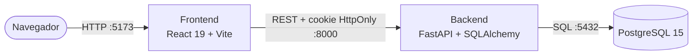

# TT 2027-A196 · ESCOM Hardware Match

**Prototipo de aplicación web para la recomendación de publicaciones de oferta de laptops y tabletas entre la comunidad de la ESCOM**

Trabajo Terminal No. 2027-A196 · Escuela Superior de Cómputo (ESCOM) · Instituto Politécnico Nacional

| | |
| :--- | :--- |
| **Alumnos** | Granados Martínez Pablo Daniel · López Hernández Alan |
| **Directora** | M. en C. Galiñanes Rodríguez María Gabriela |

## Descripción

Aplicación web que centraliza la publicación de laptops y tabletas, nuevas o de segunda mano, para la comunidad de la ESCOM. Cada oferta se captura con una **ficha técnica estandarizada** (procesador, RAM, almacenamiento, GPU, pantalla, batería) y el sistema calcula una **compatibilidad con la carrera** del comprador usando un filtrado basado en contenido (CBF) contra el plan de estudios 2020 (ISC, IIA, LCD e ISISA).

## Funcionalidad implementada

| Módulo | Qué incluye |
| :--- | :--- |
| **Cuentas** | Registro con rol (Alumno, Docente, PAAE, Externo), carrera, semestre e intereses; inicio y cierre de sesión con cookie `HttpOnly`; confirmación de correo con insignia IPN; perfil académico editable y restablecible. |
| **Publicaciones** | Alta con ficha técnica y validaciones; detección de duplicados que suma existencias; edición; cambio de estado (Activa, Vendida, Obsoleta); eliminación; sección *Mis publicaciones*. |
| **Marketplace** | Catálogo con tarjetas, ficha técnica en ventana modal, contacto del vendedor por teléfono o WhatsApp bajo demanda, favoritos. |
| **Filtros** | 13 filtros combinables (texto, tipo, marca, condición, RAM, almacenamiento, tipo de disco, GPU, rango de precio, vendedor IPN, compatibilidad con la carrera y ordenamiento). |
| **Compatibilidad (CBF)** | Puntaje de 0 a 100 % y etiqueta explicativa según carrera y especificaciones del equipo. |

El detalle de cada caso de uso, regla de negocio y endpoint está en la [documentación](#documentación).

## Arquitectura y tecnologías

Arquitectura de tres niveles, cada una en su contenedor:



| Capa | Tecnología |
| :--- | :--- |
| Presentación | React 19, Vite 8, CSS propio, Oxlint |
| Lógica de negocio | Python 3.10, FastAPI, SQLAlchemy 2, Pydantic |
| Datos | PostgreSQL 15 (volumen Docker `postgres_data`) |
| Despliegue local | Docker y Docker Compose |

## Inicio rápido

### Requisitos

- [Docker Desktop](https://www.docker.com/products/docker-desktop/) en ejecución
- Git

### Pasos

```bash
git clone https://github.com/PabloGranados/TT-2027-A196-ESCOM
cd TT-2027-A196-ESCOM

# 1. Crea tu archivo de configuración local (no se sube a GitHub)
cp .env.example .env          # en PowerShell: Copy-Item .env.example .env
# 2. Edita .env y cambia POSTGRES_PASSWORD (y opcionalmente DEMO_USER_PASSWORD)

# 3. Levanta los tres servicios
docker compose up -d --build
```

| Servicio | URL |
| :--- | :--- |
| Aplicación web | http://localhost:5173 |
| API | http://localhost:8000 |
| Documentación interactiva de la API (Swagger) | http://localhost:8000/docs |

Al primer arranque el backend crea las tablas y carga cinco publicaciones de ejemplo. Si defines `DEMO_USER_PASSWORD` en `.env`, la pantalla de inicio de sesión muestra el botón **Autocompletar** con la cuenta de demostración; si lo dejas vacío, la cuenta de ejemplo no se puede usar para iniciar sesión.

### Comandos útiles

```bash
docker compose logs -f backend     # ver registros del backend
docker compose restart frontend    # reiniciar un servicio
docker compose down                # detener (conserva los datos)
docker compose down -v             # detener y BORRAR la base de datos
```

```powershell
.\scripts\backup_db.ps1                                      # respaldo de la base de datos
.\scripts\restore_db.ps1 -File .\backups\<archivo>.sql       # restaurar un respaldo
```

## Variables de entorno

Se definen en `.env` (plantilla en [`.env.example`](.env.example)).

| Variable | Descripción | Valor por defecto |
| :--- | :--- | :--- |
| `POSTGRES_USER`, `POSTGRES_PASSWORD`, `POSTGRES_DB` | Credenciales y nombre de la base de datos | Obligatorias |
| `FRONTEND_ORIGIN` | Origen permitido por CORS | `http://localhost:5173` |
| `SESSION_TTL_SECONDS` | Duración de la sesión | `3600` |
| `COOKIE_SECURE` | Marca la cookie como `Secure`; usar `true` con HTTPS | `false` |
| `VITE_API_URL` | URL pública del backend para el frontend | `http://localhost:8000` |
| `DEMO_USER_EMAIL`, `DEMO_USER_PASSWORD` | Cuenta de demostración opcional (solo desarrollo) | Vacío |

## Estructura del repositorio

```text
.
├── backend/                  API FastAPI (main.py), Dockerfile, requirements.txt
├── frontend/                 Aplicación React (src/App.jsx, src/App.css), Dockerfile
├── docs/
│   ├── DOCUMENTACION_TECNICA.md
│   ├── base_de_datos/        Diccionario de datos, ER y schema.sql
│   └── pdf/                  Versión en PDF de la documentación
├── scripts/                  Respaldo/restauración de la base de datos y generación de PDF
├── DOCUMENTACION_CASOS_DE_USO.md
├── docker-compose.yml
└── .env.example
```

## Documentación

| Documento | Contenido | PDF |
| :--- | :--- | :--- |
| [Casos de uso](DOCUMENTACION_CASOS_DE_USO.md) | Casos de uso, reglas de negocio, filtros, algoritmo CBF y API | [PDF](docs/pdf/DOCUMENTACION_CASOS_DE_USO.pdf) |
| [Documentación técnica](docs/DOCUMENTACION_TECNICA.md) | Arquitectura, seguridad, backend, frontend, despliegue y limitaciones | [PDF](docs/pdf/DOCUMENTACION_TECNICA.pdf) |
| [Base de datos](docs/base_de_datos/DOCUMENTACION_BASE_DE_DATOS.md) | Modelo entidad-relación y diccionario de datos | [PDF](docs/pdf/DOCUMENTACION_BASE_DE_DATOS.pdf) |

Los PDF se regeneran con `node scripts/docs-pdf/build.mjs` (ver la [documentación técnica](docs/DOCUMENTACION_TECNICA.md#11-generación-de-los-pdf)).

## Seguridad

- Contraseñas con hash `scrypt` y sal aleatoria; nunca se guardan en texto plano.
- Sesión en cookie `HttpOnly` y `SameSite=Lax`; en la base de datos solo se guarda el hash SHA-256 del token. No se usa `localStorage`.
- El teléfono de contacto de una oferta solo se entrega a usuarios con sesión mediante una acción explícita.
- Las credenciales de la base de datos y de la cuenta demo viven únicamente en `.env`, que está excluido del repositorio.
- No subas el archivo `.env`, respaldos (`backups/`) ni volcados de datos reales.

## Flujo de trabajo con Git

- `main`: versión estable y documentada.
- `sprint1`, `sprint2`, …: ramas de referencia por sprint.
- Mensajes de commit con prefijo `feat:`, `fix:`, `docs:`, `style:` o `chore:`.