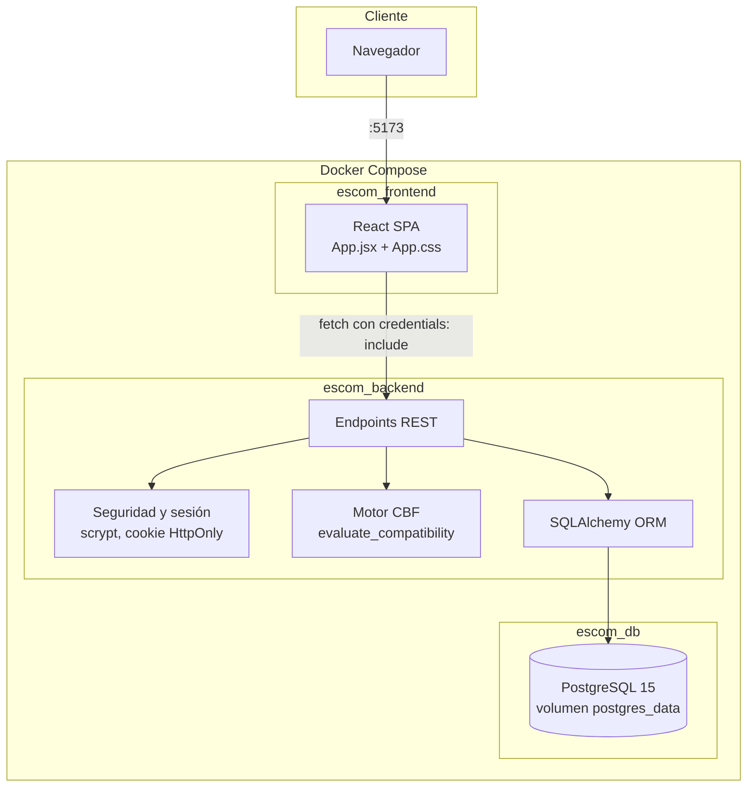
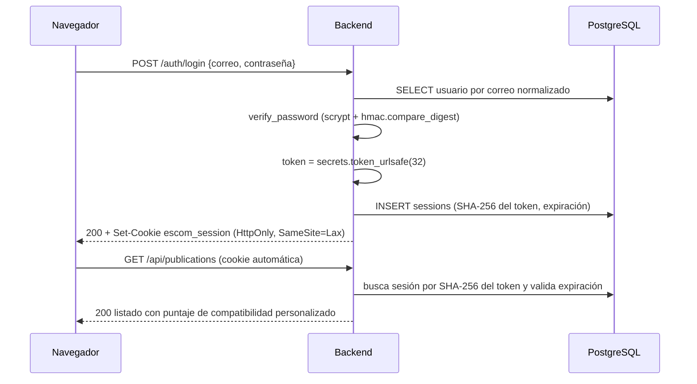

# Documentación técnica

**Trabajo Terminal No. 2027-A196 · ESCOM Hardware Match**

Complementa a la [documentación de casos de uso](../DOCUMENTACION_CASOS_DE_USO.md) y a la [documentación de la base de datos](base_de_datos/DOCUMENTACION_BASE_DE_DATOS.md).

## 1. Visión general

Aplicación web de tres niveles que se ejecuta con Docker Compose:

| Servicio | Contenedor | Puerto | Tecnología |
| :--- | :--- | :-: | :--- |
| Frontend | `escom_frontend` | 5173 | React 19 + Vite 8 |
| Backend | `escom_backend` | 8000 | Python 3.10 + FastAPI + SQLAlchemy 2 |
| Base de datos | `escom_db` | 5432 (solo `127.0.0.1`) | PostgreSQL 15 |

El código del backend y del frontend se monta como volumen (`./backend:/app`, `./frontend:/app`), por lo que los cambios en disco se recargan automáticamente (`uvicorn --reload` y el servidor de desarrollo de Vite).

## 2. Arquitectura



### Flujo de autenticación



## 3. Estructura y configuración

```text
backend/
  main.py             Modelos, esquemas, seguridad, motor CBF, semilla y endpoints
  requirements.txt    fastapi, uvicorn, psycopg2-binary, sqlalchemy
  Dockerfile
frontend/
  src/App.jsx         Aplicación completa (vistas y componentes)
  src/App.css         Estilos
  src/index.css       Estilos base
  src/main.jsx        Punto de entrada
  Dockerfile, vite.config.js, .oxlintrc.json, package.json
docs/                 Documentación (Markdown y PDF)
scripts/              backup_db.ps1, restore_db.ps1, docs-pdf/
docker-compose.yml
.env.example          Plantilla de configuración (el archivo .env real no se versiona)
```

### Variables de entorno

| Variable | Usada por | Descripción |
| :--- | :--- | :--- |
| `POSTGRES_USER`, `POSTGRES_PASSWORD`, `POSTGRES_DB` | db, backend | Credenciales y base. Obligatorias; Compose falla si faltan. |
| `DATABASE_URL` | backend | Se construye en Compose con las tres anteriores. Si no existe, el backend usa SQLite local `hardware_match.db`. |
| `FRONTEND_ORIGIN` | backend | Origen permitido por CORS (también se aceptan `localhost:5173` y `127.0.0.1:5173`). |
| `SESSION_TTL_SECONDS` | backend | Duración de la sesión y de la cookie. |
| `COOKIE_SECURE` | backend | Agrega el atributo `Secure` a la cookie. |
| `DEMO_USER_EMAIL`, `DEMO_USER_PASSWORD` | backend, frontend | Cuenta demo opcional; si la contraseña está vacía, el vendedor de los datos de ejemplo recibe una contraseña aleatoria inutilizable. |
| `VITE_API_URL` | frontend | URL pública del backend. |

## 4. Seguridad

| Aspecto | Implementación |
| :--- | :--- |
| Contraseñas | `hashlib.scrypt` (n=16384, r=8, p=1, 64 bytes) con sal aleatoria de 16 bytes; formato `scrypt$sal$hash`; comparación con `hmac.compare_digest`. |
| Sesiones | Token aleatorio de 32 bytes; en la base solo se guarda su SHA-256. Cookie `escom_session` con `HttpOnly`, `SameSite=Lax`, `Secure` configurable. Las sesiones vencidas se eliminan al detectarse. |
| Autorización | Las operaciones de escritura exigen sesión y verifican que el usuario sea propietario (HTTP 403 en caso contrario). |
| Privacidad | `contact_phone` solo se serializa al propietario; el resto lo obtiene en `/contact` con sesión (RN-06, RN-10). |
| CORS | Lista explícita de orígenes con credenciales; métodos limitados. |
| Entrada | Validación con Pydantic (longitudes y rangos); consultas con SQLAlchemy parametrizado (sin SQL concatenado). |
| Secretos | Solo en `.env` (ignorado por git); PostgreSQL publicado únicamente en `127.0.0.1`. |

## 5. Referencia de la API

Base: `http://localhost:8000`. Los errores devuelven `{"detail": "mensaje"}`. Las rutas con sesión devuelven **401** «Autenticación requerida» si falta la cookie o venció.

### 5.1 Cuentas

| Endpoint | Cuerpo / parámetros | Respuesta |
| :--- | :--- | :--- |
| `POST /auth/register` | `name`, `email`, `password` (8-128), `role` (por defecto `Alumno`), `career`, `semester`, `interests`, `phone` | **201** `UserResponse` + cookie. **409** correo duplicado. **422** datos inválidos. |
| `POST /auth/verify-email?token=` | `token` | **200** `UserResponse` verificado. **400** token inválido. |
| `POST /auth/login` | `email`, `password` | **200** `UserResponse` + cookie. **401** credenciales incorrectas. |
| `GET /auth/me` | — | **200** `UserResponse`. |
| `PUT /auth/profile` | `career`, `semester`, `interests`, `phone` (todos opcionales) | **200** `UserResponse`. |
| `DELETE /auth/profile` | — | **200** `UserResponse` con carrera, semestre e intereses en `null`. |
| `POST /auth/logout` | — | **204**; elimina la sesión y la cookie. |

`UserResponse`: `id`, `name`, `email`, `role`, `career`, `semester`, `interests`, `phone`, `is_verified`, `verification_token`, `es_institucional`, `has_complete_profile`.

### 5.2 Publicaciones

| Endpoint | Descripción |
| :--- | :--- |
| `GET /api/filters/options` | Marcas con ofertas activas, tipos, condiciones, tipos de disco, opciones de RAM y almacenamiento, criterios de orden y rango de precios. |
| `GET /api/publications` | Parámetros: `search`, `device_type`, `condition`, `min_price`, `max_price`, `brand`, `min_ram`, `min_storage`, `storage_type`, `gpu_type` (`dedicada`/`integrada`), `ipn_sellers_only`, `sort_by` (`recientes`, `precio_asc`, `precio_desc`, `compatibilidad`), `only_compatible`. **400** si se pide compatibilidad sin sesión o con perfil incompleto. |
| `GET /api/publications/{id}` | **200** `PublicationResponse`; **404** si no existe. |
| `GET /api/publications/{id}/contact` | **200** `{seller_name, seller_role, seller_career, contact}`; **400** si es el propio vendedor; **404**. |
| `POST /api/publications` | **201** `PublicationResponse`. Con duplicado exacto (RN-09) devuelve la oferta existente con las piezas sumadas. |
| `PUT /api/publications/{id}` | **200**; **403** si no es el propietario; **404**. |
| `PATCH /api/publications/{id}/status` | Cuerpo `{"status": "Activa" \| "Vendida" \| "Obsoleta"}`. **200** `{status, stock, invite_rating, message}`. |
| `DELETE /api/publications/{id}` | **204**; **403**; **404**. |
| `GET /api/my-publications` | Ofertas del usuario en cualquier estado. |

Cuerpo de `POST/PUT /api/publications` (`PublicationCreate`):

| Campo | Tipo | Regla |
| :--- | :--- | :--- |
| `title` | texto | 3-200 caracteres |
| `device_type` | texto | `Laptop` o `Tableta` |
| `brand`, `model` | texto | 1-100 / 1-150 |
| `condition` | texto | `Nuevo`, `Usado - Como nuevo`, `Usado - Buen estado`, `Usado - Con detalles` |
| `processor` | texto | 2-150 |
| `ram_gb` | entero | 2-256 |
| `storage_gb` | entero | 16-16 384 |
| `storage_type` | texto | `SSD NVMe`, `SSD SATA`, `HDD`, `eMMC` |
| `gpu`, `screen_size`, `battery_condition` | texto opcional | por defecto `Integrada`, `15.6"`, `Buena` |
| `price` | decimal | mayor a 0 |
| `stock` | entero opcional | mínimo 1 |
| `description` | texto | 5-2 500 |
| `image_url`, `contact_phone` | texto opcional | 1 000 / 50 |

`PublicationResponse` agrega: datos públicos del vendedor (`seller_*`), `status`, `created_at`, `updated_at`, `is_favorite`, `compatibility_score`, `compatibility_badge`, `compatibility_detail`.

### 5.3 Favoritos

| Endpoint | Descripción |
| :--- | :--- |
| `GET /api/favorites` | Ofertas guardadas, de la más reciente a la más antigua. |
| `POST /api/favorites/{id}` | Agrega (idempotente). |
| `DELETE /api/favorites/{id}` | Quita. |

## 6. Backend (`backend/main.py`)

| Bloque | Contenido |
| :--- | :--- |
| Configuración | Lectura de variables de entorno, motor SQLAlchemy y `SessionLocal`. |
| Modelos | `User`, `SessionToken`, `Publication`, `Favorite` (ver [base de datos](base_de_datos/DOCUMENTACION_BASE_DE_DATOS.md)). |
| Esquemas Pydantic | `Credentials`, `RegisterRequest`, `ProfileUpdateRequest`, `UserResponse`, `PublicationCreate`, `PublicationStatusUpdate`, `PublicationResponse`. |
| Seguridad | `hash_password`, `verify_password`, `create_session`, `get_optional_user`, `current_user`. |
| Reglas | `is_institutional_domain` (RN-02), `has_complete_profile` (RN-03). |
| Motor CBF | `evaluate_compatibility` devuelve `(puntaje, etiqueta, detalle)`; tabla en la [sección 6 de casos de uso](../DOCUMENTACION_CASOS_DE_USO.md#6-algoritmo-de-compatibilidad-línea-base-cbf). |
| Arranque | `initialize_database`: crea tablas, agrega columnas faltantes de `users` con `ALTER TABLE … IF NOT EXISTS`, aplica obsolescencia (RN-08) y siembra datos de ejemplo si no hay publicaciones. Reintenta la conexión hasta 10 veces. |
| Endpoints | Cuentas, publicaciones, filtros y favoritos (sección 5). |

## 7. Frontend (`frontend/src/App.jsx`)

| Componente | Responsabilidad |
| :--- | :--- |
| `App` | Estado global: usuario, vista activa, publicaciones, filtros y modal. Restaura la sesión con `/auth/me`. |
| `AuthScreen` | Inicio de sesión, registro, confirmación de correo y botón de cuenta demo opcional. |
| `CreatePublicationView` | Formulario de tres bloques para crear ofertas. |
| `MyPublicationsView` | Listado y eliminación de las ofertas propias. |
| `FavoritesView` | Listado y retiro de favoritos. |
| `ProfileView` | Consulta, edición y restablecimiento del perfil académico. |
| `PublicationModal` | Ficha técnica, compatibilidad, contacto, favoritos y acciones del propietario. |

Detalles de implementación:

- `apiRequest` centraliza `fetch` con `credentials: 'include'` y traduce los errores a mensajes legibles.
- Los filtros viven en un único objeto (`EMPTY_FILTERS`); `buildPublicationsUrl` omite los vacíos y el catálogo se recarga con cada cambio.
- La paleta usa la variable CSS `--ipn-guinda` y un tema oscuro sobrio, con diseño adaptable (puntos de corte 860 px y 640 px).
- No se guardan tokens en `localStorage`.

## 8. Base de datos y migraciones

El esquema se crea con `Base.metadata.create_all`. Como esa función no agrega columnas a tablas ya existentes, el arranque ejecuta sentencias `ALTER TABLE users ADD COLUMN IF NOT EXISTS …` para volúmenes creados con versiones anteriores. Para cambios futuros de esquema se recomienda adoptar Alembic. Más detalle en la [documentación de la base de datos](base_de_datos/DOCUMENTACION_BASE_DE_DATOS.md).

## 9. Despliegue y operación

```bash
cp .env.example .env              # una sola vez; edita las contraseñas
docker compose up -d --build      # levantar
docker compose logs -f backend    # registros
docker compose down               # detener conservando datos
```

| Tarea | Comando |
| :--- | :--- |
| Respaldar la base | `.\scripts\backup_db.ps1` |
| Restaurar un respaldo | `.\scripts\restore_db.ps1 -File .\backups\<archivo>.sql` |
| Entrar a PostgreSQL | `docker exec -it escom_db psql -U <POSTGRES_USER> -d <POSTGRES_DB>` |
| Reconstruir el esquema documentado | `docker exec escom_db pg_dump -U <POSTGRES_USER> -d <POSTGRES_DB> --schema-only --no-owner --no-privileges > docs/base_de_datos/schema.sql` |

**Aviso sobre Visual Studio Code:** el repositorio incluye `.vscode/settings.json` con `files.hotExit: off` para evitar que el editor restaure copias antiguas de archivos abiertos y sobrescriba el trabajo guardado en disco.

## 10. Limitaciones conocidas

| Tema | Situación actual |
| :--- | :--- |
| Correo de verificación | No se envía correo; el token se devuelve en la respuesta del registro. |
| Obsolescencia (RN-08) | Se evalúa al iniciar el backend, no de forma periódica. |
| Edición de ofertas | Disponible solo en la API. |
| Valoraciones de vendedores | Pendiente; solo existe la bandera `invite_rating`. |
| Cuenta demo | Su contraseña llega al bundle de Vite; usar únicamente en desarrollo local. |
| Protección contra fuerza bruta | No hay límite de intentos de inicio de sesión. |
| Migraciones | Mediante `ALTER TABLE` manual; sin Alembic. |
| Pruebas automatizadas | No hay suite; la verificación es manual y con lint/build (sección 12). |
| Obsolescencia visual del catálogo | Las ofertas `Vendida` u `Obsoleta` no aparecen en *Explorar*, solo en *Mis publicaciones*. |

## 11. Generación de los PDF

Los PDF de `docs/pdf/` se generan a partir de los Markdown, con los diagramas Mermaid renderizados como imágenes. Requiere Node.js y Google Chrome o Microsoft Edge instalados.

```bash
cd scripts/docs-pdf
npm install
node build.mjs
```

Si el navegador no está en la ruta habitual, define `CHROME_PATH` con la ruta del ejecutable.

## 12. Verificación

```bash
cd frontend
npm run lint      # Oxlint: 0 advertencias y 0 errores
npm run build     # compilación de producción con Vite
```

Pruebas manuales recomendadas tras cada cambio: registro, inicio y cierre de sesión, creación de una oferta, aplicación de cada filtro, apertura del detalle, contacto con el vendedor, favoritos, cambio de estado y eliminación.

