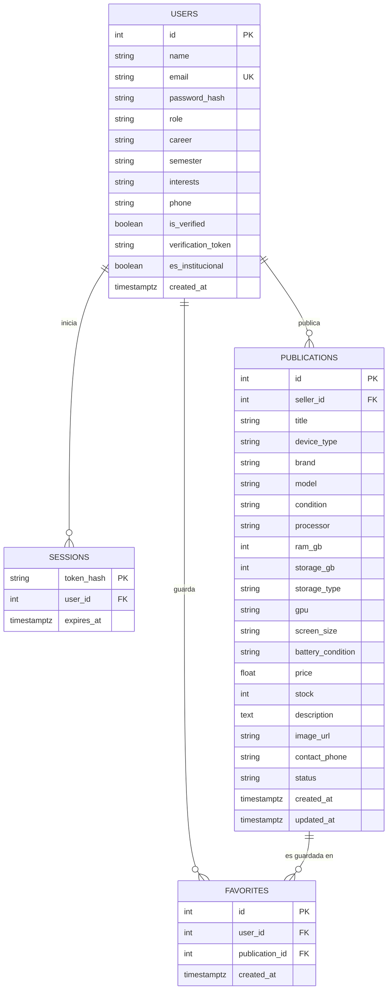

# Documentación de la Base de Datos

**Proyecto:** Trabajo Terminal No. 2027-A196 – ESCOM, IPN
**Motor:** PostgreSQL 15 (contenedor `escom_db`)
**Base de datos:** `hardware_match_db`
**ORM:** SQLAlchemy 2.x (modelos en [`backend/main.py`](../../backend/main.py))

## Archivos relacionados

| Archivo | Contenido |
| :--- | :--- |
| [`schema.sql`](schema.sql) | Esquema real exportado con `pg_dump` (tablas, llaves, índices). |
| `DOCUMENTACION_BASE_DE_DATOS.md` | Este documento: modelo entidad-relación y diccionario de datos. |
| [`../../DOCUMENTACION_CASOS_DE_USO.md`](../../DOCUMENTACION_CASOS_DE_USO.md) | Casos de uso, reglas de negocio y endpoints. |
| [`../../scripts/backup_db.ps1`](../../scripts/backup_db.ps1) | Respaldo de la base de datos a `backups/`. |
| [`../../scripts/restore_db.ps1`](../../scripts/restore_db.ps1) | Restauración desde un respaldo. |

Para regenerar el esquema después de un cambio en los modelos:

```powershell
docker exec escom_db pg_dump -U escom_user -d hardware_match_db --schema-only --no-owner --no-privileges > docs/base_de_datos/schema.sql
```

## 1. Modelo entidad-relación



## 2. Diccionario de datos

### 2.1 `users`

| Campo | Tipo | Nulo | Descripción |
| :--- | :--- | :---: | :--- |
| `id` | integer | No | Llave primaria. |
| `name` | varchar(120) | No | Nombre completo. |
| `email` | varchar(320) | No | Correo normalizado en minúsculas. Índice único `ix_users_email`. |
| `password_hash` | varchar(512) | No | Hash scrypt con sal; nunca se guarda la contraseña. |
| `role` | varchar(50) | No | `Alumno`, `Docente`, `PAAE` o `Externo`. |
| `career` | varchar(100) | Sí | Carrera (solo para alumnos): ISC, IIA, LCD o ISISA. |
| `semester` | varchar(50) | Sí | `1° semestre` … `8° semestre`. |
| `interests` | varchar(500) | Sí | Intereses académicos separados por coma. |
| `phone` | varchar(50) | Sí | Teléfono o WhatsApp de contacto. |
| `is_verified` | boolean | No | Correo confirmado. |
| `verification_token` | varchar(100) | Sí | Token de confirmación de correo. |
| `es_institucional` | boolean | No | `true` si el correo pertenece a un dominio del IPN. |
| `created_at` | timestamptz | No | Fecha de registro. |

### 2.2 `sessions`

| Campo | Tipo | Nulo | Descripción |
| :--- | :--- | :---: | :--- |
| `token_hash` | varchar(64) | No | Llave primaria. SHA-256 del token de sesión (el token real vive solo en la cookie `HttpOnly`). |
| `user_id` | integer | No | FK → `users.id` (`ON DELETE CASCADE`). |
| `expires_at` | timestamptz | No | Expiración de la sesión. Índice `ix_sessions_expires_at`. |

### 2.3 `publications`

| Campo | Tipo | Nulo | Descripción |
| :--- | :--- | :---: | :--- |
| `id` | integer | No | Llave primaria. |
| `seller_id` | integer | No | FK → `users.id` (`ON DELETE CASCADE`). |
| `title` | varchar(200) | No | Título de la oferta. |
| `device_type` | varchar(50) | No | `Laptop` o `Tableta`. |
| `brand` | varchar(100) | No | Marca. |
| `model` | varchar(150) | No | Modelo. |
| `condition` | varchar(50) | No | `Nuevo`, `Usado - Como nuevo`, `Usado - Buen estado`, `Usado - Con detalles`. |
| `processor` | varchar(150) | No | CPU. |
| `ram_gb` | integer | No | Memoria RAM en GB. |
| `storage_gb` | integer | No | Almacenamiento en GB. |
| `storage_type` | varchar(50) | No | `SSD NVMe`, `SSD SATA`, `HDD`, `eMMC`. |
| `gpu` | varchar(150) | Sí | Tarjeta gráfica (por defecto `Integrada`). |
| `screen_size` | varchar(50) | Sí | Tamaño de pantalla (ej. `15.6"`). |
| `battery_condition` | varchar(100) | Sí | Estado de la batería. |
| `price` | double precision | No | Precio en MXN. |
| `stock` | integer | No | Piezas disponibles. Se pone en 0 al marcar la oferta como vendida. |
| `description` | text | No | Descripción y observaciones. |
| `image_url` | varchar(1000) | Sí | URL de la fotografía. |
| `contact_phone` | varchar(50) | Sí | Teléfono de contacto de la oferta. |
| `status` | varchar(50) | No | `Activa`, `Vendida`, `Obsoleta`. |
| `created_at` / `updated_at` | timestamptz | No | Fechas de creación y última modificación. |

### 2.4 `favorites`

| Campo | Tipo | Nulo | Descripción |
| :--- | :--- | :---: | :--- |
| `id` | integer | No | Llave primaria. |
| `user_id` | integer | No | FK → `users.id` (`ON DELETE CASCADE`). |
| `publication_id` | integer | No | FK → `publications.id` (`ON DELETE CASCADE`). |
| `created_at` | timestamptz | No | Fecha en que se guardó. |

## 3. Relaciones y reglas de integridad

| Relación | Cardinalidad | Comportamiento al borrar |
| :--- | :---: | :--- |
| `users` → `sessions` | 1 : N | Se eliminan las sesiones del usuario. |
| `users` → `publications` | 1 : N | Se eliminan sus publicaciones. |
| `users` → `favorites` | 1 : N | Se eliminan sus favoritos. |
| `publications` → `favorites` | 1 : N | Se elimina el favorito al borrar la publicación. |

## 4. Campos utilizados por los filtros del catálogo

| Filtro | Campo(s) de la base de datos |
| :--- | :--- |
| Búsqueda por texto | `title`, `brand`, `model`, `processor`, `description` |
| Tipo de equipo | `publications.device_type` |
| Marca | `publications.brand` |
| Condición | `publications.condition` |
| RAM mínima | `publications.ram_gb` |
| Almacenamiento mínimo | `publications.storage_gb` |
| Tipo de disco | `publications.storage_type` |
| Tarjeta gráfica | `publications.gpu` |
| Rango de precio | `publications.price` |
| Vendedor con correo IPN | `users.es_institucional` (unión con `seller_id`) |
| Compatibilidad con mi carrera | `users.career` del comprador contra `ram_gb`, `gpu`, `processor`, `storage_type` |
| Ordenamiento | `created_at`, `price`, puntaje de compatibilidad calculado |

## 5. Persistencia de los datos

Los datos se guardan en el volumen de Docker `postgres_data`, por lo que **sobreviven** a reinicios de contenedores, de Docker y de Visual Studio Code. Solo se pierden si se ejecuta alguno de estos comandos:

```powershell
docker compose down -v        # elimina el volumen
docker volume rm tt_postgres_data
```

Para conservar una copia segura de los datos:

```powershell
.\scripts\backup_db.ps1
```

## 6. Conexión directa

| Parámetro | Valor |
| :--- | :--- |
| Host | `localhost` |
| Puerto | `5432` |
| Base de datos | `hardware_match_db` |
| Usuario | `escom_user` |
| Contraseña | `escom_password` |

```powershell
docker exec -it escom_db psql -U escom_user -d hardware_match_db
```
